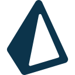
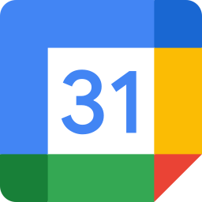
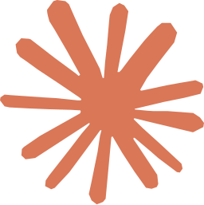
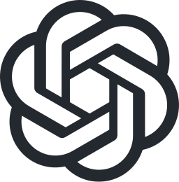
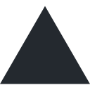
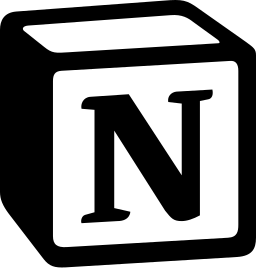
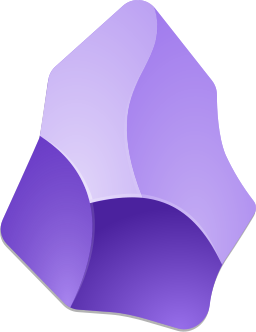

 

Cuido da tecnologia na **[Aurora](https://auroradev.space)**, a agência que criei com o Samuel Lima em 2025.
A gente constrói sistemas do zero para problemas reais: plataformas sob medida, atendimento com IA no WhatsApp,
automações em n8n e dashboards com os dados do negócio em tempo real.
Estudo Engenharia de Software na UVV e moro em Vila Velha, ES.

 

## Em construção

| Projeto | O que é | Stack |
|:--|:--|:--|
| **[Site da Aurora](https://auroradev.space)** | Site institucional e funis de captação, em produção | Next.js · React · Tailwind · GSAP · Three.js |
| **Sistema interno da Aurora** | CRM, projetos e financeiro da agência, multiusuário com permissões por papel | Next.js · Supabase · PostgreSQL |
| **Resultado Final** | Inscrições, numeração e entrega de kit para corridas de rua, com guichês funcionando sem internet | TypeScript · Next.js · PostgreSQL · Turborepo |
| **Plataforma Café** | Certificação e gestão para a cafeicultura familiar, com app de campo que funciona offline | Python · Flet · FastAPI · MySQL |
| **Captação de leads com IA** | Atendimento automático no WhatsApp para um corretor nos EUA | n8n · Supabase · WhatsApp |
| **[EchoSense](https://github.com/tarsyllammassoli/EchoSense)** | Monitoramento de bem-estar animal por visão computacional (InovaWeek) | React · Vite · Recharts |

## Como eu trabalho

Cada projeto tem o próprio canvas no **Maestri**, com um time de agentes de IA.
Eu decido o quê e o porquê; o Maestro divide o trabalho, os agentes constroem, um revisa, outro testa, e nada vai pra produção sem o meu ok.

## Stack

<table>
<tr>
<td width="190"><b>FRONT-END</b></td>
<td>
&nbsp;&nbsp;
&nbsp;&nbsp;
<picture><source media="(prefers-color-scheme: dark)" srcset="logos/nextjs.svg" /></picture>&nbsp;&nbsp;
&nbsp;&nbsp;
 também: GSAP, Three.js, Motion, Flet
</td>
</tr>
<tr>
<td width="190"><b>BACK-END</b></td>
<td>
&nbsp;&nbsp;
&nbsp;&nbsp;
&nbsp;&nbsp;
&nbsp;&nbsp;

</td>
</tr>
<tr>
<td width="190"><b>DADOS</b></td>
<td>
&nbsp;&nbsp;
&nbsp;&nbsp;
&nbsp;&nbsp;
&nbsp;&nbsp;
&nbsp;&nbsp;
&nbsp;&nbsp;
<picture><source media="(prefers-color-scheme: dark)" srcset="logos/prisma.svg" /></picture>&nbsp;&nbsp;
<picture><source media="(prefers-color-scheme: dark)" srcset="logos/drizzle.svg" /></picture> também: Power BI
</td>
</tr>
<tr>
<td width="190"><b>AUTOMAÇÃO</b></td>
<td>
&nbsp;&nbsp;
&nbsp;&nbsp;
&nbsp;&nbsp;

</td>
</tr>
<tr>
<td width="190"><b>IA</b></td>
<td>
&nbsp;&nbsp;
<picture><source media="(prefers-color-scheme: dark)" srcset="logos/codex.svg" /></picture>&nbsp;&nbsp;
&nbsp;&nbsp;
 orquestrados no Maestri, com OpenCode e GitHub Copilot
</td>
</tr>
<tr>
<td width="190"><b>TESTES E INFRA</b></td>
<td>
&nbsp;&nbsp;
&nbsp;&nbsp;
&nbsp;&nbsp;
<picture><source media="(prefers-color-scheme: dark)" srcset="logos/vercel.svg" /></picture>&nbsp;&nbsp;
<picture><source media="(prefers-color-scheme: dark)" srcset="logos/aws.svg" /></picture>&nbsp;&nbsp;
&nbsp;&nbsp;
<picture><source media="(prefers-color-scheme: dark)" srcset="logos/github.svg" /></picture>
</td>
</tr>
<tr>
<td width="190"><b>NO DIA A DIA</b></td>
<td>
&nbsp;&nbsp;
&nbsp;&nbsp;

</td>
</tr>
</table>

## Contato

**[auroradev.space](https://auroradev.space)** &nbsp;·&nbsp; [LinkedIn](https://www.linkedin.com/in/bernardozsubtil) &nbsp;·&nbsp; [Instagram da Aurora](https://www.instagram.com/aurorasync.ai)
