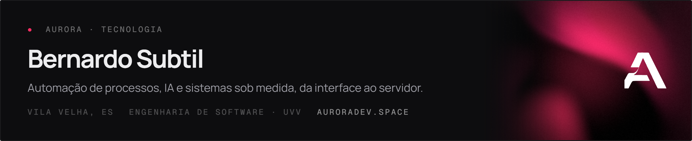
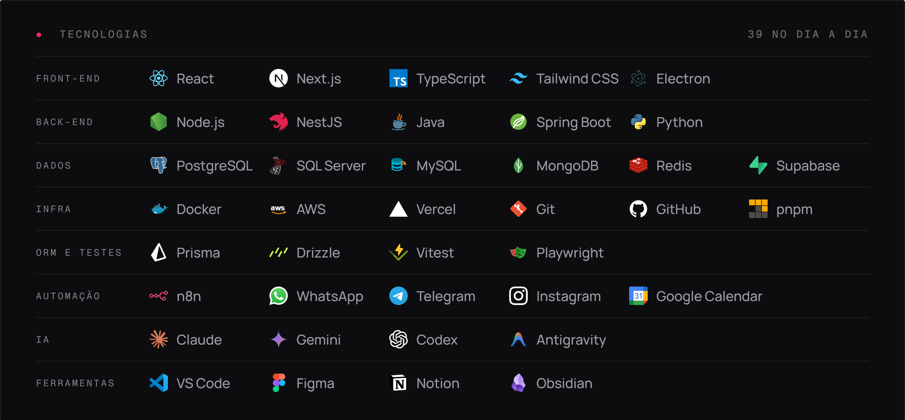

 

Cuido da tecnologia na **[Aurora](https://auroradev.space)**: sistemas sob medida, atendimento com IA no WhatsApp, automações e dashboards em tempo real.

 

 

<a href="https://auroradev.space">auroradev.space</a> &nbsp;·&nbsp; <a href="https://www.linkedin.com/in/bernardozsubtil">LinkedIn</a> &nbsp;·&nbsp; <a href="https://www.instagram.com/aurorasync.ai">Instagram</a>
